# FrogEye

FrogEye is a competitive-intelligence app for JFrog. Every morning it reads what JFrog's competitors and the wider DevOps and software-supply-chain market published in the last day: releases, advisories, blog posts, news, job postings, pricing pages and repos. AI agents then turn that into a cited, fact-checked **Morning Briefing** for each team (Sales, Product, Exec, PMM/DevRel). The same evidence feeds a profile of each competitor, a pressure view for each JFrog product, and a matrix that compares JFrog with everyone on one screen.

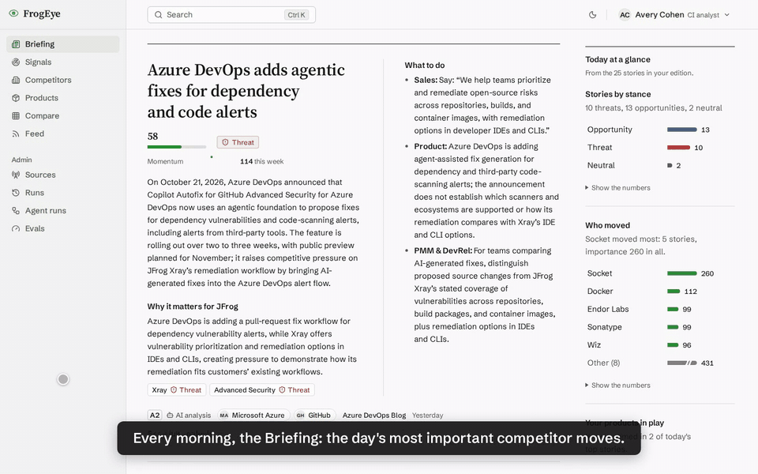

▶ **[Full demo video (3 min)](media/demo.mp4)** · [Screenshots](#screenshots) · [How it works](#how-it-works) · [Evaluation](#evaluation) · [Challenges](#challenges-and-pitfalls) · [Now vs. next](#built-now-vs-next)

## In one minute

- **Daily, automatic.** One scheduled run a day collects from 140 public sources, drops noise and duplicates, groups coverage of the same event into one story, and publishes the briefing to the web app, email and (optionally) Slack.
- **"So what for JFrog", not a news feed.** Each story says what happened, which JFrog products it affects (threat, opportunity or neutral), and what each team should do about it.
- **Every claim has a source.** Analyses carry numbered citations to the articles they rest on. Quotes and numbers are checked against those sources in code, and a fact-checker model removes what the sources don't support before anyone reads it.
- **How JFrog compares.** Competitor profiles (products vs. JFrog, momentum, hiring, funding, pricing-page changes), a deep dive per JFrog product, and a **Compare** matrix of JFrog's 13 products against 17 competitors.
- **Measured, not assumed.** An evaluation harness scores triage, competitor disambiguation, search, the guardrails, the fact-checker and the faithfulness of stored analyses. It replays with no API key and no cost.
- **Cheap and transparent.** About $0.25 for a typical day. Hard daily and lifetime caps, and every model call is visible with its tokens, cost and latency. The whole project (building, live runs and evals) spent about $1.40 on OpenAI.

## Quickstart

Prerequisite: Docker with Compose v2. Python, Node, Postgres and Redis all run in containers. An OpenAI API key is optional: without one FrogEye collects and filters but does no AI analysis.

```bash
cp .env.example .env            # Windows PowerShell: Copy-Item .env.example .env
# optional: put your key in .env as OPENAI_API_KEY=... to turn on AI analysis
docker compose up -d --build
```

The first start loads a **demo snapshot** of the data this project collected and analysed, captured on 22 Oct 2026 (briefings, signals and their analyses, competitor and product intelligence, agent runs), so every page is populated without a key; the top bar (on a wide screen) says "Demo data captured 22 Oct 2026". Give it about a minute, until `docker compose ps` shows everything healthy. New data arrives with the daily run (06:00 Asia/Jerusalem), which needs an OpenAI key to analyse anything.

Views that count from today (open roles, "this week") reflect the capture date, so they thin out as the snapshot ages: a job board counts as stale three days after its last full listing. `docker compose exec api python -m app.cli.run_ingestion` refreshes the job boards, watched pages and feeds without a key.

The snapshot is restored only into a brand-new, empty database, once, before the migrations; an existing database is never touched. It ships without the full article text (each article keeps a 1,200-character excerpt and its link). Its LLM-call ledger (about $1.11) counts toward the lifetime cap. Set `DEMO_SNAPSHOT=off` in `.env` before the first start for an empty start instead: the migrations run and the configuration is seeded (competitors, sources, capabilities, key intelligence topics, demo personas). On an empty start with a key set, run these two once:

```bash
docker compose exec api python -m app.cli.build_kb                # JFrog knowledge base, well under $0.01
docker compose exec api python -m app.cli.run_daily --max-usd 2   # first run: catches up on two weeks of backlog
```

The first run collects about 5,000 items and takes about 25 minutes (about $0.33 on this project's first run). After that the schedule runs every day at 06:00 Asia/Jerusalem.

`.env.example` ships a placeholder `JWT_SECRET` that is only fit for a local demo; set a long random value (`openssl rand -hex 32`) for anything else.

### Web UI

Open <http://localhost:8080> and sign in with any demo persona; the password for all of them is `frogeye-demo`. Each persona reads the briefing edition for its role (sign in as another persona to see another edition). Briefing emails are caught by Mailpit at <http://localhost:8025>.

| Persona | Email | Role |
|---|---|---|
| Avery Cohen | analyst@frogeye.local | CI analyst (starts runs, sees review states and agent arguments) |
| Sam Rivera | sales@frogeye.local | Sales |
| Priya Shah | pm@frogeye.local | Product management |
| Eli Morgan | exec@frogeye.local | Exec |
| Noa Bar | devrel@frogeye.local | PMM / DevRel |

| Page | What it shows |
|---|---|
| **Briefing** (home) | The day's Morning Briefing in the reader's own edition: Sales, PM, Exec and PMM/DevRel each get theirs, and the CI analyst reads the master. Top-story cards say what happened, why it matters for JFrog (with the affected products) and what this role should do; themed sections list the other stories. Earlier days are one click away. |
| **Signal analysis** (`/signals/:id`) | One story's full analysis, read like an article: what happened, background, what changed, the impact on each affected JFrog product, competitive implications, actions per role, risks, what to watch. Every factual paragraph has numbered citations that jump to its sources. |
| **Signals** | Every analysed story, filterable by competitor, type, stance, importance, date, capability and topic, with a quick-look drawer. Hybrid (semantic + keyword) search across articles, signals and the JFrog knowledge base; it falls back to keyword search without a key. |
| **Competitors** | The landscape (overlap with JFrog against momentum), a sortable table, and a deep dive per competitor: bottom line with citations, products vs. JFrog, momentum, hiring, headcount and funding (reported facts only), customers, pricing-page changes, community, partners, latest signals. |
| **Products** | JFrog's 13 products, most pressed first, and a deep dive per product: who competes with it, weekly threat vs. opportunity, gaps and parity, competitor hiring in its area. |
| **Compare** | JFrog's 13 products × 17 competitors in one matrix: each cell shows their competing products and the evidence-based threat to that product, and opens the evidence. |
| **Feed** | The raw collected documents, with competitor chips. |
| **Admin** | **Sources** (health per source), **Runs** (ingestion funnel, **Run now** for analysts), **Agent runs** (every graph run with its step-by-step trace and the AI spend panel), **Evals** (the latest evaluation results). |

FrogEye watches competitors and the market, so it never files news about JFrog itself; JFrog appears only as the subject of "why it matters" and the recommended actions.

## Screenshots

| | |
|---|---|
| 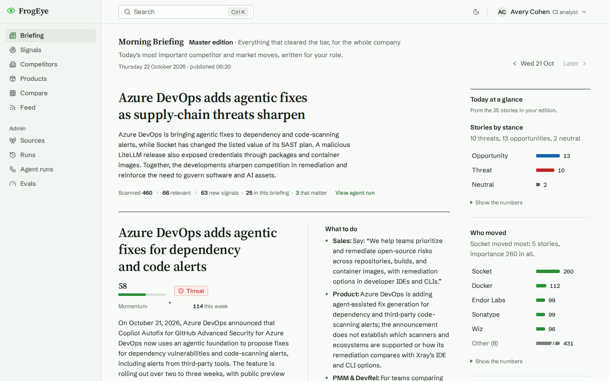 **Morning Briefing**, master edition | 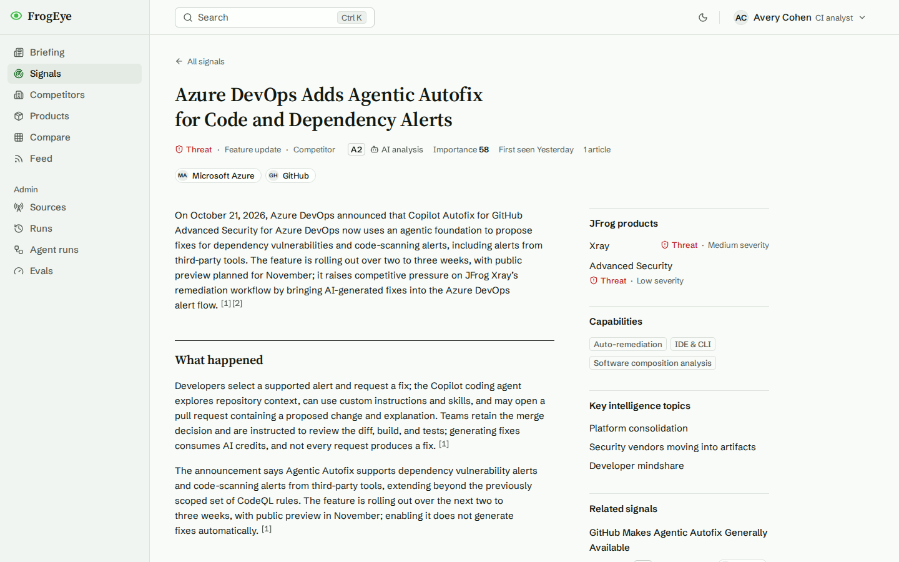 **Signal analysis** with numbered citations |
| 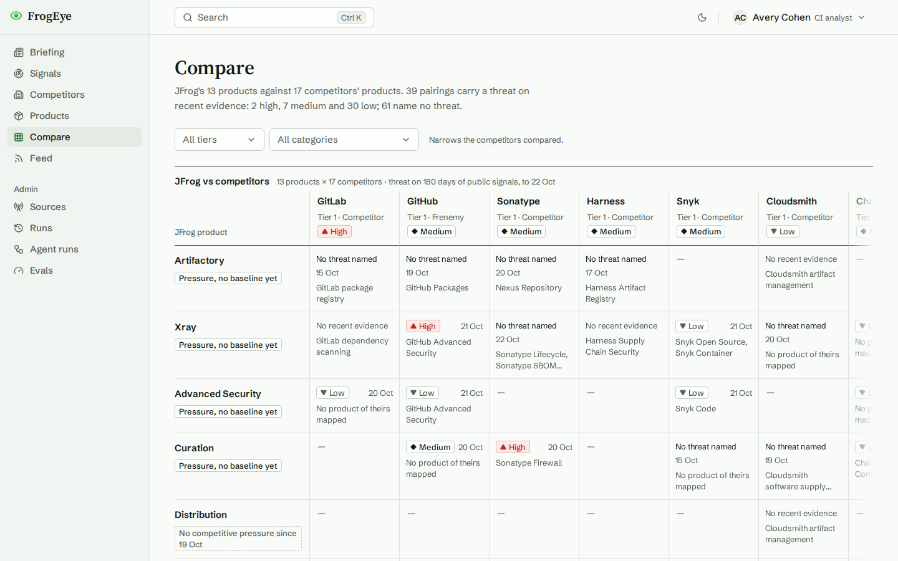 **Compare**: JFrog vs. competitors | 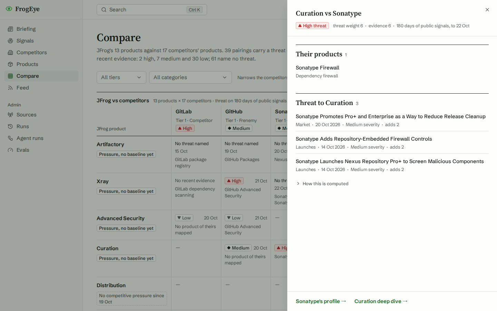 A Compare cell and its evidence |
| 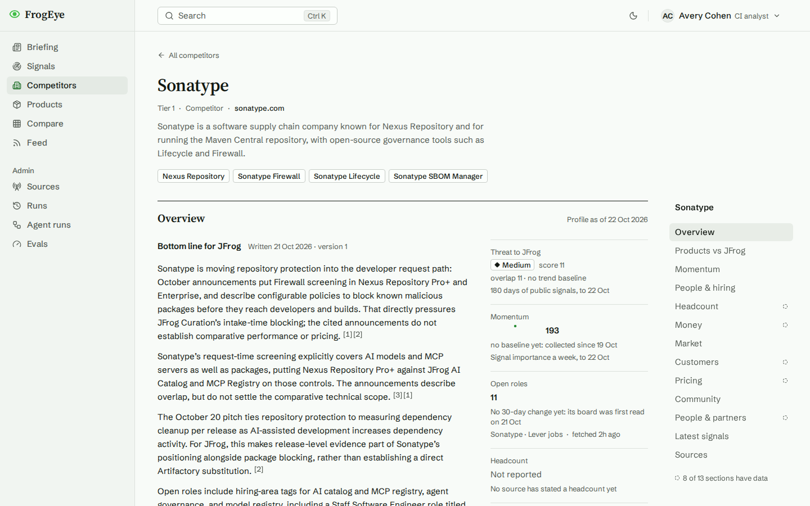 **Competitor** deep dive | 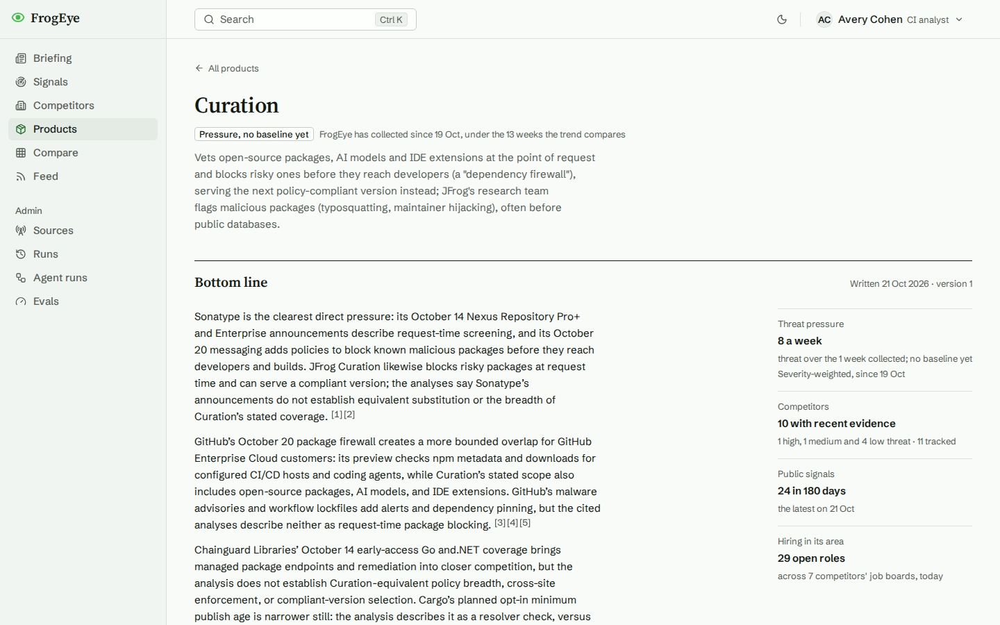 **Product** deep dive |
| 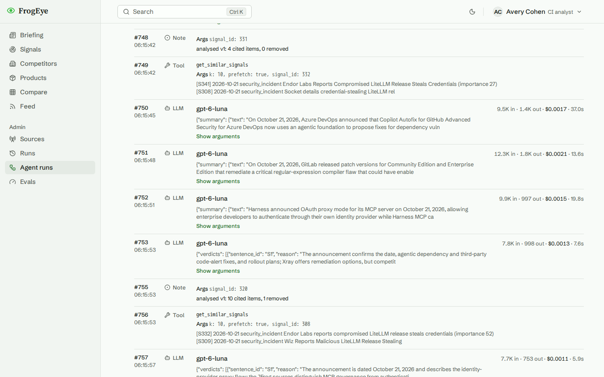 **Agent run** trace: every call, its tokens and cost | 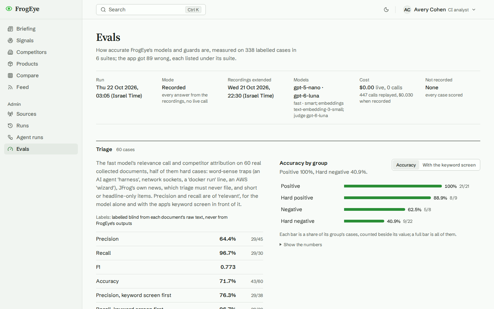 **Evals** page |

More in [media/screenshots](media/screenshots): the role editions, the Signals explorer, the competitor and product lists, the AI spend panel, the briefing email, dark mode and a phone view.

## How it works

### Architecture

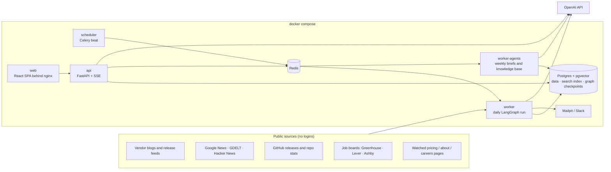

- **Celery decides when and where work runs** (schedules, queues, isolation of long jobs). **LangGraph decides what runs** (typed state, nodes, checkpoints, retries).
- **One Postgres** holds the data, the hybrid search index (pgvector plus full-text) and the LangGraph checkpoints. That means one store, one backup, and joins and filters inside the search query.
- **The data is layered**: raw items → normalised documents → stories and signals → analyses and briefings. Agents can be re-run with new prompts or models without fetching anything again.
- **Live progress** streams to the browser over Server-Sent Events: the current stage, steps as they finish, a refreshed briefing, and a toast for breaking signals.

### The daily graph

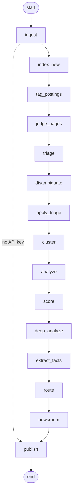

| Step | What happens | AI? |
|---|---|---|
| **ingest** | Collect, normalise, deduplicate (SimHash), keyword pre-filter. | no |
| **index_new** | Embed new documents for search. | embeddings |
| **tag_postings** | Label new job postings with the JFrog product areas the role itself works on. | smart model |
| **judge_pages** | Judge whether a watched pricing/about page change matters; a meaningful one becomes a document. | fast model |
| **triage** | Is this relevant to JFrog's market, and which competitor is it about? | fast model |
| **disambiguate** | An agent with tools re-judges ambiguous names (Harness, Socket, Mend, Wiz, Aqua, Docker…). | smart model + tools |
| **cluster** | Coverage of the same event from several outlets becomes one story. | fast model |
| **analyze** (stage A) | The Analyst agent extracts the fact, impact on JFrog, actions per role and supporting quotes. | smart model + tools |
| verify (inside analyze) | Every quote must match its source almost verbatim; every number must appear in a source. Failures go back to the analyst once, then to `needs_review`. | no |
| **score** | Importance from impact, novelty, competitor tier, signal type, topic priority, source credibility and corroboration, decayed by age. Headline-only and "no JFrog product affected" stories are damped. | no |
| **deep_analyze** (stage B) | The full cited analysis of the most important stories (see [How accuracy is protected](#how-accuracy-is-protected)). | smart model |
| **extract_facts** | Funding, headcount, customers, acquisitions and leadership changes, each with a verbatim quote that must match its source. | smart model |
| **route** | Breaking signals (importance 85+) become live alerts. | no |
| **newsroom** | A subgraph: an editor plans the briefing, a fact-checker checks the editor's text, role adapters build the four editions. Card text is copied from the verified analyses, never rewritten. | smart + fast |
| **publish** | File the briefing, email each persona its edition, post to Slack. | no |

The graph is checkpointed in Postgres after every node, so a run interrupted by a restart resumes where it stopped (`run_daily --resume`). Weekly jobs refresh the JFrog knowledge base and write a cited "bottom line for JFrog" per competitor and per product.

### Agents and tools

Agency is bounded on purpose. The graph's shape is fixed, and agents choose tools only inside their own node. Every agent has a tool allowlist and a cap on tool calls, and all tools are read-only: no agent can write data or publish. Writes happen in deterministic nodes, after validation.

| Agent | Model tier | Tools (read-only) |
|---|---|---|
| Analyst (stage A) | smart | `get_jfrog_context` (JFrog knowledge base), `get_similar_signals`, `get_kit` (key intelligence topics); at most 4 calls |
| Disambiguator | smart | `lookup_competitor`, `search_intel` (hybrid search); at most 3 calls |
| Newsroom editor | smart | `query_signals`, `get_similar_signals` |
| Stage-B writer and fact-checker | smart | none (structured output only) |
| Triage, clustering, newsroom fact-checker, role adapters, page-change judge | fast | none |
| Competitor and product brief writers, posting tagger | smart | none |

The tool loop is a small custom runner rather than a prebuilt ReAct agent ([tool_agent.py](backend/app/agents/runtime/tool_agent.py)). It caps tool calls, wraps every tool result as untrusted data so scraped text cannot pose as instructions, and ends with one structured call whose schema the output must satisfy. Every model call goes through one accounted client, which caches identical requests, records each call in a ledger and a trace, and enforces the budgets.

Models are configured in `.env` by tier: `MODEL_FAST` (default `gpt-5-nano`), `MODEL_SMART` (default `gpt-6-luna`) and `EMBEDDING_MODEL` (`text-embedding-3-small`, 512 dimensions). Prices per model live in [pricing.py](backend/app/agents/runtime/pricing.py); an unknown model is priced at the most expensive known rate.

### How accuracy is protected

Each layer is measured by the [evaluation harness](#evaluation).

1. **Citations constrained by the schema.** Stage B's output schema accepts only the reference ids of the sources the model was shown, so it cannot cite a source it didn't see. The summary and "what happened" must cite one of the story's own articles, and any statement about JFrog must rest on the JFrog brief or a knowledge-base page.
2. **Quote and number checks in code.** Stage-A quotes must match their source (fuzzy, with a high threshold). A number guard drops any item whose figures its cited sources don't contain.
3. **A model fact-checker.** It reads each item against only the sources that item cites. Its schema makes it write its reasoning before its verdict; the evals showed why that order matters (see [Experiments](#what-the-evals-changed)). Items left without a verdict are asked again once.
4. **Fail closed.** If the summary doesn't survive, or the checker still leaves items unjudged, nothing is stored; the story keeps its short first take, labelled "Full analysis pending".
5. **Untrusted content stays data.** Scraped text and tool results are wrapped and labelled as untrusted, and no tool can write.
6. **Honest states.** A story with only a headline says "Limited evidence: headline only". A trend without 13 weeks of history says "no baseline yet". A missing data source is stated ("No public Greenhouse, Lever or Ashby board found"), never filled in.

## Evaluation

[backend/evals](backend/evals/README.md) runs the app's real functions on labelled datasets built from the data FrogEye collected, and records every model answer. `make eval` replays the recordings, reproducing the numbers with **no API key and no cost**; CI runs that replay on every push. The same results are on the **Admin › Evals** page.

```bash
docker compose -f docker-compose.test.yml run --rm -T eval python -m evals.run    # make eval (replay)
make eval-record                                                                    # re-record live, capped at $0.30
```

| Suite | Cases | What it measures | Result (21 Oct 2026) |
|---|---|---|---|
| Triage | 60 real documents, half hard cases (an AI "agent harness", network sockets, `docker run`, JFrog's own news) | relevance precision / recall | recall **96.7%**, precision **64.4%** (76.3% with the keyword screen in front) |
| Competitor disambiguation | 28 ambiguous mentions | right company or none | **92.9%** after the agent vs. 67.9% for triage alone (7 fixed, 0 broken) |
| Search | 25 analyst queries | recall@8 / MRR@10 for four retrieval modes | hybrid **0.967 / 1.000**; vector 0.954 / 0.980; keyword 0.618 / 0.760; hybrid + LLM rerank 0.962 / 0.903 |
| Guardrails (no AI) | 58: genuine quotes and numbers, plus planted fakes | fakes caught / false alarms | **100%** caught (37/37), **0** false alarms (0/21) |
| Stage-B fact-checker | 30 claims, 16 with planted errors | errors removed / true claims removed | **16/16** removed, **0/14** true claims removed |
| Faithfulness | 137 items from 20 real stored analyses, judged by a separate model | supported / partial / unsupported | **56.9% / 40.9% / 2.2%**; 219/219 citations resolve |

Recording everything cost $0.04.

**Method.** Labels were assigned blind from each document's raw text, never from FrogEye's outputs; [LABELS.md](backend/evals/datasets/LABELS.md) lists every label with its reason.
Faithfulness is rated by a separate judge model; most "partial" ratings are interpretive framing in "why it matters" and summaries, not wrong facts.

### What the evals changed

The evals found real problems, and two were fixed and re-measured:

- **The fact-checker was the weak layer.** It removed only 8 of 16 planted errors, and twice its reason said "unsupported" while its verdict passed the claim, because the schema had the model write the verdict before the reason. The experiment compared three variants:

  | Variant | Errors removed | True claims removed | Stage-B cost per analysis |
  |---|---|---|---|
  | a: verdict first, fast model (before) | 8/16 | 0/14 | $0.0023 |
  | b: reason first, sharper prompt, fast model | 12/16 | 0/14 | $0.0024 |
  | c: reason first, sharper prompt, smart model (**adopted**) | 16/16 | 0/14 | $0.0028 |

  Option c costs about $0.03 more on a busy day.
- **The number guard had a gap.** "October 3" passed because "3" matched inside "3,000". It's fixed, and the guardrail suite went from 36/37 to 37/37.

They also explain two design choices:

- **The LLM rerank is off by default.** It made ranking worse (MRR 1.00 → 0.90).
- **The keyword screen stays in front of triage.** It lifts triage precision from 64% to 76%.

## Challenges and pitfalls

What was hard, and what went wrong.

1. **Names that aren't companies.** "Harness" is also an AI agent harness and a wiring harness; "Socket" is a network socket; `docker run` appears in every tutorial. Aliases and negative keywords help, but the disambiguation agent is what fixes it (68% → 93% on the eval set). Job-board discovery hit the same problem: the first search matched Socket's token to Socket Labs, a crypto startup. Every found board is now checked by hand before it is trusted.
2. **The small model over-reaches.** In 5 of 60 eval cases, triage on `gpt-5-nano` listed most of the competitor list (up to 31 slugs, with repeats) for one article. It also often names no vendor for a vendor's own news. It filed 4 of 5 JFrog-only items as relevant despite its prompt. The keyword screen stops 3 of them, but one ("JFrog Business Value Center") passes both layers. Triage precision (64%) is the clearest next improvement.
3. **Hallucination needs layers, and the layers need measuring.** Schema-constrained citations, code checks and a model fact-checker each catch different failures. Only the evals showed the fact-checker was missing half the planted errors, and that a field-order detail in its schema was the cause.
4. **Collecting without being blocked.** Several vendor blogs return 403 to non-browser clients (they get a browser User-Agent; nothing else does). GDELT answered 429 on the very first request. SEC EDGAR requires a contact in the User-Agent, so it stays disabled. The answer is a small footprint:
   - one run a day, at most 1 request per second per site;
   - a per-host circuit breaker (23 hours after a 403 or 429, then 7 days);
   - `robots.txt` respected for article pages;
   - job boards and watched pages read at most once a day, whatever triggers it;
   - no logins, no LinkedIn, no paid data.
5. **Sources we chose not to use.**
   - **LinkedIn and G2/Gartner Peer Insights:** their terms of service forbid scraping.
   - **Reddit:** API access now needs manual approval.
   - **NewsAPI and GNews free tiers:** no production use.
   - **Bing News API:** retired.
6. **Budget.** The goal was under $10 for the whole project, so:
   - a keyword pre-filter runs before any model, and clustering runs before extraction;
   - identical requests are cached, and two model tiers are routed by task;
   - stage B, the expensive step, keeps a reserve so the briefing always gets written;
   - hard daily and lifetime caps: when one is hit, the run still collects, and the briefing is filed as "skipped: budget reached" instead of failing.
7. **Trends need time.** Momentum and product pressure compare the last 4 weeks with the 9 before, so a fresh install reads "no baseline yet" until 13 weeks are collected, and open-role lines start with the second daily snapshot. The pages say so rather than drawing lines through two points.
8. **Long runs and restarts.** A backlog run takes 25 minutes. Checkpointing every node means a restart loses nothing, and `--resume` continues from the last finished step.

## Built now vs. next

| | Built and demonstrable now | Next, given more time and resources |
|---|---|---|
| **Collection** | 140 public sources (vendor feeds, GitHub, Hacker News, Google News, GDELT), job boards, page watch, polite fetching with a circuit breaker | Field intel (Gong/Chorus call notes, Salesforce competitor fields, win/loss interviews), the highest-value CI input. Licensed news and analyst feeds under contract. Fuller text extraction for the watched pages that yield little text today |
| **Analysis** | Triage, disambiguation, clustering, two analysis stages with citations and fact-checking, verified company facts, weekly cited briefs | Better triage precision (prompt and model experiments through the harness, then a fine-tuned small classifier). A capability-level parity matrix rated by an agent with citations, reviewed by an analyst |
| **Comparison** | Competitor profiles, product deep dives, the Compare matrix from mapped products and evidence-based threat | Battlecards per competitor, kept fresh from new signals. Head-to-head view. Time travel ("what did the matrix say last quarter?"). Merging stories that run over several days and outlets into one signal, so a story covered again days later doesn't appear twice. A wider competitor-product seed, so that every Compare cell whose signals name a JFrog product also shows the competing product |
| **People in the loop** | Role editions, `needs_review` state, analyst-only trace details | A review queue that pauses the graph for approval (LangGraph interrupts), with feedback that tunes ranking |
| **Delivery** | Web app, email per persona, Slack webhook, live progress | An "Ask FrogEye" copilot over the same tools. Slack/Teams bot. An MCP server exposing FrogEye's tools to other assistants. CRM deal alerts |
| **Quality** | 6-suite evaluation harness with record/replay in CI, about 1,300 backend and 430 frontend tests, a Playwright smoke test | Larger labelled sets, a held-out fact-checker set, score gates in CI, production tracing (LangSmith or Langfuse) |
| **Operations** | One `docker compose up`, a sanitized demo snapshot that fills a fresh install without a key, budgets, a spend ledger, step traces | SSO and roles, a hosted deployment with a managed Postgres, a scheduled snapshot refresh |

## Why these choices

- **LangGraph rather than a free-form multi-agent framework.** An explicit state machine with typed state, Postgres checkpoints (resume after a crash), conditional edges and fan-out. Agents work inside a controlled graph rather than chatting with each other, so cost and behaviour stay predictable and testable.
- **Agents only at judgment points.** Disambiguation, analysis, editing and fact-checking use models. Fetching, deduplication, verification and scoring are code, which is cheaper, deterministic and unit-tested.
- **Structured outputs everywhere, with ids as enums.** Every model output is validated against a strict JSON schema, and a citation can only be a source the model was shown.
- **Deterministic scoring.** Models are poorly calibrated on numbers, so they supply ordinal judgements and code blends them into an explainable, tunable score.
- **pgvector + full-text in one Postgres.** Hybrid search with metadata filters and joins in one query, and no second datastore. The search eval backs the choice: hybrid beats keyword by a wide margin and edges out vector-only.
- **Two model tiers, a cache and hard caps.** Quality where it matters, pennies elsewhere, and no surprise bills.
- **A minimal LangChain surface with hash-locked dependencies** (`uv.lock`, `package-lock.json`). Supply-chain hygiene, which seemed fitting for JFrog.
- **Public, terms-respecting sources only.** Reliable, legal and cheap; the excluded ones are listed under [Challenges](#challenges-and-pitfalls).

## References

The official documentation of the data sources FrogEye collects from:

- [Greenhouse Job Board API](https://docs.greenhouse.io/job-board.html)
- [Lever Postings API](https://github.com/lever/postings-api)
- [Ashby Job Postings API](https://developers.ashbyhq.com/docs/public-job-posting-api)
- [GDELT DOC 2.0 API](https://blog.gdeltproject.org/gdelt-doc-2-0-api-debuts/)
- [Hacker News Search API (Algolia)](https://hn.algolia.com/api)
- GitHub REST API: [releases](https://docs.github.com/en/rest/releases/releases) and [repositories](https://docs.github.com/en/rest/repos/repos)
- Google News RSS search feeds (`news.google.com/rss/search`), which Google does not document

The JFrog knowledge base is built from JFrog's public product pages, listed in [jfrog_kb.yaml](backend/app/seed/jfrog_kb.yaml).

## Operating FrogEye

<details>
<summary><b>Budgets, costs and the first run</b></summary>

Two hard caps in `.env`: `LLM_DAILY_BUDGET_USD` (default `0.75`, per calendar day in Asia/Jerusalem) and `LLM_TOTAL_BUDGET_USD` (default `9`, lifetime spend recorded in this database). When a cap is reached mid-run the run finishes cleanly: unprocessed documents wait for the next run and the day's briefing is filed as `skipped_budget`, which the Briefing page explains. Stage B stops early instead, leaving `NEWSROOM_RESERVE_USD` (default `0.05`) for the briefing.

Measured on this project's live runs (from the `llm_calls` ledger):

| What | Work done | Time | Cost |
|---|---|---|---|
| `build_kb` | 15 JFrog pages fetched, 40 search chunks | 23 s | $0.0004 |
| First daily run (`--max-usd 2`, 14-day backlog) | 5,139 items fetched, 310 triaged, 224 signals, 120 analysed, 5 briefings | 26 min | $0.327 |
| An ordinary daily run | 80 items, 13 new signals, 19 full analyses, briefing | 11 min | $0.077 |
| First run with competitor intelligence | 344 items, 42 signals, 37 full analyses, 300 postings tagged, 56 sources read for facts, 5 briefings | 21 min | $0.189 |
| `generate_briefs` | 24 competitor and product briefs | 6 min | $0.038 |
| Daily run, 22 Oct 2026 (fact-checker and posting tagger on the smart model) | 460 items, 40 full analyses, briefing and four editions | 20 min | $0.245 |

A full analysis costs about $0.0028 since the fact-checker moved to the smart model. A typical day costs about $0.25; a quiet day with a hundred new documents costs less.

The first run analyses up to two weeks of backlog (`ANALYSIS_LOOKBACK_DAYS=14`, at most `TRIAGE_CAP=400` documents triaged and `ANALYSIS_CAP=120` stories analysed per run), so run it once from the command line with a raised cap: `run_daily --max-usd 2`. `--max-usd X` raises the **day's** cap to X for that one process (the day's earlier spend counts toward it, and it never lifts the total cap). `--resume` continues the latest interrupted run (less than 6 hours old).

A briefing covers analysed signals first published in the last 7 days that no earlier briefing carried, so a late story still reaches the next briefing, exactly once. Running again on the same day files version 2 of that day's briefing; email and Slack go out again only if its stories changed.
</details>

<details>
<summary><b>Commands</b></summary>

All run with `docker compose exec api …`.

| Command | What it does |
|---|---|
| `python -m app.cli.run_daily [--max-usd X] [--resume]` | The full daily graph |
| `python -m app.cli.run_ingestion` | Collect only, no AI (results under **Feed** and **Admin › Sources**) |
| `python -m app.cli.check_sources` | Probe every source once |
| `python -m app.cli.build_kb` | Crawl and re-embed the JFrog knowledge base (also weekly, Sundays 05:00) |
| `python -m app.cli.analyze_signals [--max-usd X] [--limit N]` | Backfill full analyses for existing signals |
| `python -m app.cli.discover_job_boards [--competitor SLUG] [--dry-run]` | Find public job boards; check each one by hand |
| `python -m app.cli.tag_postings [--max-usd X] [--limit N]` | Tag untagged open postings |
| `python -m app.cli.extract_facts [--max-usd X] [--limit N] [--lookback-days N]` | Read unread sources for company facts |
| `python -m app.cli.generate_briefs [--max-usd X] [--competitor SLUG]... [--product NAME]...` | Write competitor and product briefs now (also weekly, Sundays 05:30) |
| `python -m app.cli.host_blocks [--clear HOST \| --clear-all]` | Inspect or clear the per-host circuit breaker |
| `python -m app.seed` | Apply edited seed YAML (`backend/app/seed/`) to an existing database |
| `python -m app.cli.apply_profile` | Apply the collection-footprint profile to existing sources |

`make snapshot` rebuilds the demo snapshot (`backend/snapshot/`) from this stack's database: one read-only `pg_dump`, sanitised and scanned for secrets in a throwaway database of the test project (`python -m app.cli.build_snapshot`); rebuild the images after.

The LLM backfills print one JSON line with `cost_usd`, exit 1 while a daily run holds the lock and 2 without an OpenAI key.

**First start with job boards:** `discover_job_boards`, then hand-check the boards and disable any wrong one under **Admin › Sources**; `run_daily --max-usd <today + 1.5>`; `tag_postings` until `tagged` is 0; `extract_facts --lookback-days 90`; `generate_briefs`.
</details>

<details>
<summary><b>Collection footprint</b></summary>

- One scheduled run a day, roughly 200 requests, at most 1 request per second per site; Google News paced at 10 s and GDELT at 15 s.
- A 403 or 429 (after retries) pauses that host: 23 h after the first strike, 7 days after the second (API hosts: 1 h, then 6 h). State is in the database.
- Nothing signs in anywhere. A GitHub token is optional and only raises API limits.
- `robots.txt` is ignored for RSS/Atom feeds and documented APIs (as a feed reader does) and respected for article pages, watched pages and the JFrog knowledge base.
- A browser User-Agent only for three vendor feeds that block bots (Checkmarx, Aqua, Black Duck); everything else sends `HTTP_USER_AGENT`, with no contact details.
- Job boards (through the ATS vendors' public embed APIs) and watched pages: at most one request per day each, claimed in the database before the request.
- Manual runs have a 30-minute cooldown (`RUN_COOLDOWN_MINUTES`). A VPN is not recommended: datacenter IPs get blocked far more often than a home connection.
</details>

<details>
<summary><b>Operational pitfalls</b></summary>

- **The schedule spends while the stack is up** (daily at 06:00, weekly jobs on Sundays). Stop the stack with `docker compose down` if you don't want unattended spend.
- **The daily cap counts the whole day.** A run after a big backlog run on the same day may find the budget used up. **Run now** always uses `LLM_DAILY_BUDGET_USD`; only the CLI takes `--max-usd`.
- **`docker compose down -v` deletes everything**, including the spend ledger. Use plain `down`.
- **Stopping the stack mid-run** leaves the run `interrupted`; `run_daily --resume` continues it.
- **Rebuild after pulling** (`docker compose up -d --build`): the images bake in the tokenizer files.
- **Windows Git Bash** rewrites container paths: prefix `docker compose exec/run` commands that pass absolute paths with `MSYS_NO_PATHCONV=1`.
</details>

## Tests

All test tooling runs in containers in a separate Compose project (`frogeye-test`, its own throwaway Postgres). No test calls OpenAI: the agents run against a scripted fake model.

```bash
docker compose -f docker-compose.test.yml run --rm -T api-test ruff check app tests evals
docker compose -f docker-compose.test.yml run --rm -T api-test pytest
docker compose -f docker-compose.test.yml run --rm web-test npm run lint
docker compose -f docker-compose.test.yml run --rm web-test npx tsc --noEmit
docker compose -f docker-compose.test.yml run --rm web-test npx vitest run
docker compose -f docker-compose.test.yml run --rm -T eval python -m evals.run   # eval replay
docker compose -f docker-compose.test.yml run --rm web-e2e                      # Playwright smoke, against the stack on :8080
```

CI (`.github/workflows/ci.yml`) runs ruff, pytest, the eval replay, lint, type-check, vitest, the production build and both Docker image builds. `make` wraps the common commands (`make up`, `make test`, `make eval`, `make types`, `make graphs`). Three tests marked `live_llm` call the real API (under a cent) and are skipped unless `RUN_LIVE_LLM=1` and a key are set.

The demo video and screenshots are produced by a scripted Playwright tour ([frontend/e2e/demo](frontend/e2e/demo)). With the stack up, it makes no AI calls:

```bash
MSYS_NO_PATHCONV=1 docker compose -f docker-compose.test.yml run --rm -v ./.demo-work:/media-work -e DEMO_OUT=/media-work web-e2e npx playwright test -c playwright.demo.config.ts
sh frontend/e2e/demo/encode.sh .demo-work media
```

## Repository layout

```
backend/
  app/
    agents/      graphs (daily_intel, newsroom), nodes, tools, prompts, runtime (accounted LLM client, tool loop)
    collectors/  RSS, GitHub, Hacker News, Google News, GDELT, job boards, page watch
    processing/  normalise, dedup, prefilter
    rag/         hybrid search, indexing, JFrog knowledge base
    intel/       competitor profiles, products, hiring, facts, briefs
    api/v1/      FastAPI routes (compare.py builds the matrix from intel/)
    seed/        competitors, competitor products, sources, capabilities, topics, personas
    snapshot/    restores the demo snapshot into a brand-new database
  snapshot/      the demo snapshot (gzip'd SQL dump and its manifest)
  evals/         datasets, suites, recordings, results
  tests/
frontend/src/    features (briefing, signals, competitors, products, compare, admin), chart kit, generated API types
media/           demo video, preview GIF, screenshots
DESIGN.md        the UI design system
```
